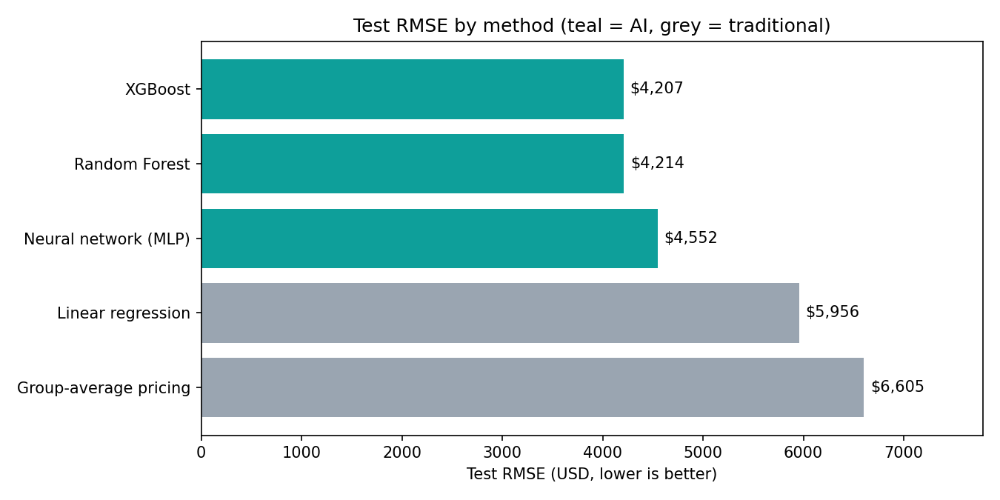
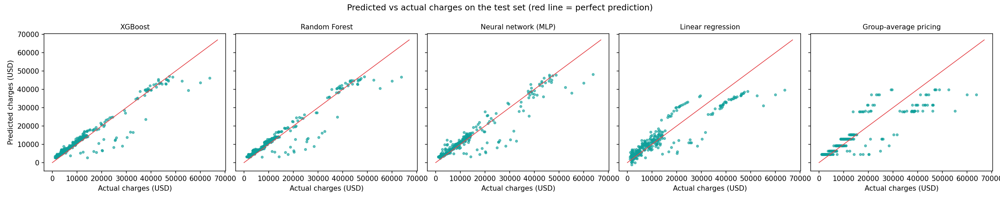
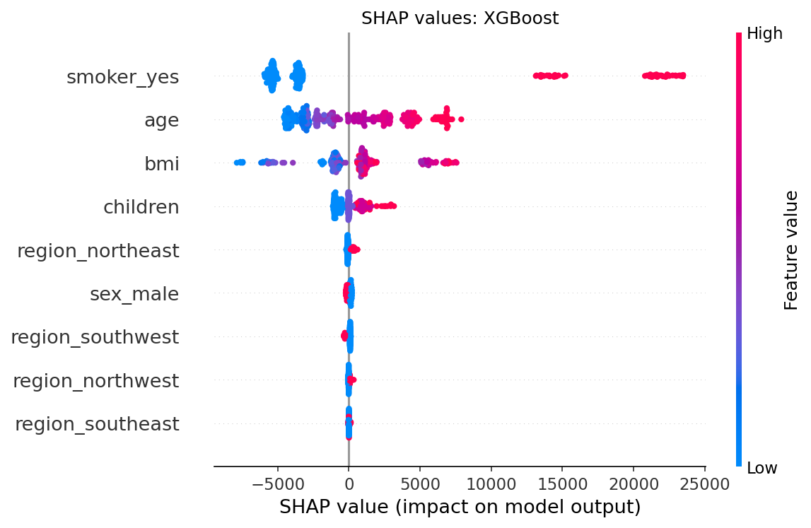

# Predicting Medical Insurance Costs with Machine Learning

CSC340 Artificial Intelligence project, School of Information Technology, KMUTT.

**Research question:** Can machine learning models predict an individual's medical insurance charges more accurately than traditional methods?

**Answer:** Yes. The best AI model (XGBoost) had a test RMSE of **$4,207**, which is **29.4% lower** than the best traditional method (linear regression, $5,956).

## Team

- Prin Phakanon (67130500845)
- Supphanyu Phaniphad (67130500866)

## Dataset

[Medical Cost Personal Datasets](https://www.kaggle.com/datasets/mirichoi0218/insurance) from Kaggle, used in the book *Machine Learning with R* by Brett Lantz.

- 1,338 rows, 7 columns, no missing values (1 duplicate row is removed, leaving 1,337)
- Inputs: `age`, `sex`, `bmi`, `children`, `smoker`, `region`
- Target: `charges`, individual medical costs billed by health insurance (USD)

> **Note:** The data is simulated from US Census Bureau demographic statistics, not real patient records. Results may differ on real insurance data.

The dataset is not included in this repository. Download `insurance.csv` from Kaggle and put it in the project folder.

## Methods

The data is split into 80% train (1,069 rows) and 20% test (268 rows) with a fixed random seed. All methods use the same 10-fold cross-validation splits on the training set, and the test set is used only once, at the end.

| Type | Method | Details |
|---|---|---|
| Traditional | Group-average pricing | Average charges by 10-year age group and smoking status, like an insurance rate table |
| Traditional | Multiple linear regression | One-hot encoded categories |
| AI | Random Forest | Tuned with grid search + 10-fold CV |
| AI | XGBoost | Tuned with grid search + 10-fold CV |
| AI | Neural network (MLP) | Tuned with grid search + 10-fold CV; inputs and target are standardised |

- Main metric: **RMSE**, with MAE and R² as support
- Model explanation: **SHAP** values for the best AI model, chosen by cross-validation RMSE

Best settings found by grid search:

| Model | Best settings |
|---|---|
| Random Forest | 500 trees, max depth 4, min samples per leaf 10 |
| XGBoost | 200 trees, max depth 3, learning rate 0.03, subsample 0.8 |
| MLP | Hidden layers (64, 32), alpha 1.0, learning rate 0.01 |

## Results

### Test set (268 rows)

| Method | Type | RMSE | MAE | R² |
|---|---|---|---|---|
| XGBoost | AI | $4,207 | $2,481 | 0.904 |
| Random Forest | AI | $4,214 | $2,465 | 0.903 |
| Neural network (MLP) | AI | $4,552 | $2,630 | 0.887 |
| Linear regression | Traditional | $5,956 | $4,177 | 0.807 |
| Group-average pricing | Traditional | $6,605 | $4,323 | 0.763 |

### 10-fold cross-validation (train set)

| Method | Type | RMSE (mean ± std) | MAE | R² |
|---|---|---|---|---|
| XGBoost | AI | $4,500 ± $677 | $2,525 | 0.839 |
| Random Forest | AI | $4,531 ± $713 | $2,579 | 0.836 |
| Neural network (MLP) | AI | $4,824 ± $613 | $2,865 | 0.819 |
| Linear regression | Traditional | $6,134 ± $547 | $4,239 | 0.710 |
| Group-average pricing | Traditional | $6,460 ± $560 | $4,257 | 0.679 |





### What drives the predictions (SHAP, XGBoost)

Smoking is by far the most important factor, followed by age and BMI. Sex and region have almost no effect.

| Feature | Mean \|SHAP\| (USD) |
|---|---|
| smoker_yes | 7,841 |
| age | 3,244 |
| bmi | 2,141 |
| children | 741 |
| region_northeast | 130 |
| sex_male | 122 |
| region_southwest | 114 |
| region_northwest | 43 |
| region_southeast | 13 |



### Key findings

- All 3 AI models beat both traditional methods, in both cross-validation and the test set.
- XGBoost and Random Forest perform almost the same (test RMSE differs by $7).
- The MLP performs worse than the tree models, likely because the dataset is small.
- The traditional methods make large errors for people with high charges.

## Run the demo

There are two demos. Both use the trained XGBoost model (test RMSE $4,207).

### Option 1: Web demo (no installation)

Open `docs/index.html` in any web browser. Everything runs in the browser.

To get a public link with GitHub Pages: in this repository go to **Settings → Pages**, set **Source** to "Deploy from a branch", choose branch `main` and folder `/docs`, then click **Save**. After a minute the demo is live at `https://<your-username>.github.io/<repository-name>/`.

### Option 2: Gradio app (Python)

The trained model (`model.joblib`) is included, so you don't need the dataset to run the app.

```bash
pip install -r requirements.txt
python app.py
```

Then open http://127.0.0.1:7860 in your browser. Enter age, sex, BMI, children, smoker and region to get a predicted cost and the top 3 factors behind it.

Example: a 45-year-old male smoker with BMI 36 (northeast, no children) gets a predicted **$42,992**; smoking raised the estimate by $22,503 compared with the average prediction of $13,004.

> Use the exact library versions in `requirements.txt`; a different scikit-learn or XGBoost version may fail to load `model.joblib`. To rebuild the model yourself, put `insurance.csv` in this folder and run `python train_model.py`.

## How to run the experiment

1. Download `insurance.csv` from [Kaggle](https://www.kaggle.com/datasets/mirichoi0218/insurance) and put it in the same folder as `experiment.py`.
2. Install the libraries:
   ```bash
   pip install pandas numpy scikit-learn xgboost shap matplotlib
   ```
3. Run the experiment (about 3 minutes):
   ```bash
   python experiment.py
   ```

Results are saved to the `results/` folder. With the fixed random seed, the numbers should match the tables above. The results were produced with scikit-learn 1.8.0, XGBoost 3.4.1, SHAP 0.54.1, pandas 3.0.2, and NumPy 2.4.4.

## Project structure

```
.
├── app.py                 # Gradio demo
├── model.joblib           # Trained XGBoost model used by the demos
├── train_model.py         # Retrains model.joblib from insurance.csv
├── experiment.py          # Full experiment: data split, tuning, evaluation, SHAP
├── requirements.txt
├── docs/
│   └── index.html         # Web demo (works offline and on GitHub Pages)
├── README.md
└── results/
    ├── cv_results.csv     # 10-fold cross-validation scores
    ├── test_results.csv   # Final test set scores
    ├── best_params.json   # Best settings from grid search
    ├── shap_importance.csv
    ├── rmse_comparison.png
    ├── pred_vs_actual.png
    └── shap_summary.png
```

## References

1. M. Choi, "Medical Cost Personal Datasets," Kaggle. https://www.kaggle.com/datasets/mirichoi0218/insurance
2. B. Lantz, *Machine Learning with R*. Packt Publishing, 2019.
3. R. Kshirsagar *et al.*, "Accurate and interpretable machine learning for transparent pricing of health insurance plans," *Proc. AAAI*, 2021. https://doi.org/10.1609/aaai.v35i17.17776
4. B. Zhang, H. Huang, and D. Wang, "Medical insurance cost prediction using gradient boosting regression: A machine learning approach," *Informatica*, 2025. https://doi.org/10.31449/inf.v49i23.8100
5. L. Breiman, "Random forests," *Machine Learning*, 2001. https://doi.org/10.1023/A:1010933404324
6. T. Chen and C. Guestrin, "XGBoost: A scalable tree boosting system," *Proc. KDD*, 2016. https://doi.org/10.1145/2939672.2939785
7. S. M. Lundberg and S.-I. Lee, "A unified approach to interpreting model predictions," *NeurIPS*, 2017. https://papers.nips.cc/paper/7062-a
8. F. Pedregosa *et al.*, "Scikit-learn: Machine learning in Python," *JMLR*, 2011. https://jmlr.org/papers/v12/pedregosa11a.html
